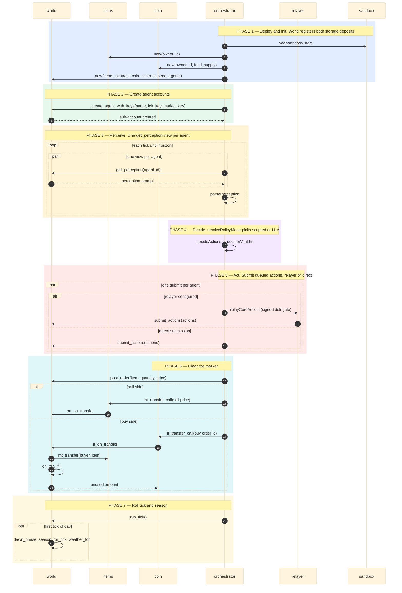

# eidolon

19 agents run a village economy on NEAR. Each villager holds a wallet, an inventory, a body, a job, and a daily routine. One deterministic tick resolves actions, production, spoilage, tax, and market settlement. Items are NEP-245 tokens (`MultiToken` derive: NEP-245 core, metadata, NEP-145 storage). Token ids are the 18 village goods. Coin is a NEP-141 fungible token with fixed supply and `decimals: 0`. This repository is an executable specification of contracts, scripted agents, and tests. [ATTRIBUTION.md](ATTRIBUTION.md) gives the origin and the pinned upstream revision.



## Architecture

| Component | Account | Responsibility |
|---|---|---|
| `contracts/world` (`eidolon-world`) | `world.eidolon.testnet` | World state, tick, production, market escrow, mirrors, NEP-297 events, views |
| `contracts/items` (`eidolon-items`) | `items.eidolon.testnet` | NEP-245 item tokens. World owns, mints, and burns them |
| `contracts/coin` (`eidolon-coin`) | `coin.eidolon.testnet` | NEP-141 coin. Init mints a fixed supply to world. Transfers only |
| `orchestrator/` | off-chain | Fetches perception, chooses scripted or LLM actions, submits them, calls `run_tick` |

Views do not read token balances. `coin_balance_mirror` and `item_balance_mirror` record every balance change, and callbacks and cross-contract flows own all balance updates. Deployed WASM sizes are 176,164 B (items), 138,149 B (coin), and 282,138 B (world).

## Simulation rules

- 16 ticks per day, 7 days per season, 112 ticks per season. Tick 1 is `Monday, 06:00`, spring, day 1. One tick is one simulated hour.
- Recipes, season multipliers, satiation, spoilage, tool wear, hunger, tax, and initial prices match the origin tables.
- Order ids use `(tick << 20) | seq`. Fill ids use `(tick << 20) | next_fill_seq`.
- The sleep roll is `((tick / 16) * 19 + agent_index) % 100`.
- The engine uses no RNG and no wall clock, so identical inputs produce identical state.

## Quickstart

```bash
npm install
npm run demo
```

The demo needs only Node.js. It starts a local `near-sandbox` chain and deploys release contracts. It runs 19 scripted agents for 49 ticks with zero real funds, no faucet, and no API keys. `npm run demo` prints one snapshot per simulated day. `npm run measure` runs the 49-tick workload and prints gas and wall time per tick. `npm test` runs the unit, vector, relayer, 49-tick simulation, and 112-tick determinism suites. Contract builds need Rust, `cargo-near`, and `near-cli-rs`:

```bash
(cd contracts/items && cargo near build non-reproducible-wasm)
(cd contracts/coin && cargo near build non-reproducible-wasm)
(cd contracts/world && cargo near build non-reproducible-wasm)
cp .env.example .env
# edit .env, then
bash scripts/deploy.sh
```

`scripts/deploy.sh` builds and deploys items, coin, and world in sequence. It initializes each contract and prints storage commands. Orchestrator targets are `get_perception`, `submit_actions`, and `run_tick`. The relayer path is a later wave.

## Dry-run demo

The default horizon is 49 ticks (three simulated days). Set `EIDOLON_TICKS=112` for a seven-day season. Output from the W4 Ubuntu 24.04 single-vCPU run:

```text
eidolon demo: 19 agents, 49 ticks, zero real funds, scripted policy
day 1: wealth=642 gini_bps=3848 gdp=0 scarce=meat,medicine
day 2: wealth=642 gini_bps=3848 gdp=0 scarce=meat,medicine
day 3: wealth=642 gini_bps=3848 gdp=0 scarce=meat,medicine
day 4: wealth=642 gini_bps=3848 gdp=0 scarce=meat,medicine
demo complete: 4 dawn snapshots, 49 ticks
```

`npm run measure` on the same host gives:

```text
49 ticks in 76.41s; 27.98 Tgas/tick (Box A, 2026-11-14)
storage: 629,209 B across world/items/coin
```

Gas sums `receipts_outcome[].outcome.gas_burnt` over 49 ticks. Storage sums `view_account.storage_usage` across world, items, and coin. `demo.mjs` and `scripts/measure.mjs` import `tests/demo-runner.mjs`, so both measure identical work.

## Environment variables

| Variable | Meaning | Variable | Meaning |
|---|---|---|---|
| `WORLD_ACCOUNT` | World contract account id | `ITEMS_ACCOUNT` | Items contract account id |
| `COIN_ACCOUNT` | Coin contract account id | `NEAR_NETWORK` | `testnet` or `mainnet` |
| `NEAR_RPC_URL` | JSON-RPC endpoint used by the orchestrator | `RELAYER_URL` | NEP-366 relayer endpoint |
| `RELAYER_ACCOUNT` | Relayer account id | `RELAYER_PRIVATE_KEYS` | Comma-separated relayer keys (secret, env only) |
| `NEAR_AI_API_KEY` | NEAR AI Cloud API key (secret, env only) | `NEAR_AI_BASE_URL` | OpenAI-compatible gateway base URL |
| `NEAR_AI_MODEL` | Model id for NPC decisions | `WORLD_OWNER_KEY` | World owner secret key used to call `run_tick` |
| `AGENT_KEYSTORE_DIR` | Directory for generated NPC keys (gitignored) | `EIDOLON_TICKS` | Demo/measure horizon (default 49) |

`.env` and `.keys/` are gitignored. No secret value belongs in a tracked file.

## Scope

This build includes NEP-245 items with owner-gated mint, burn, and NEP-145 storage, and a NEP-141 fixed-supply coin. It includes world state, economy tables, deterministic time and body rules, events, genesis init, and views. It includes a deterministic scripted NPC policy and an optional NEAR AI Cloud policy. It includes direct action submission and owner-invoked tick execution. It defers village meetings, proposals, votes, and laws, plus god mode, the scenario harness, and world generation. It also defers multi-village travel, player-controlled agents, loans, hired labor, wages, and barter scanning.

## Platform limits

NEAR sandbox binaries support Linux x86_64, Linux aarch64, and macOS arm64. Windows and Intel macOS throw `Unsupported platform`, so run tests and demos inside WSL2 or Linux CI. Contract builds need only Rust. Node 26 is the pinned LTS line.

## Attribution and license

This port derives from an MIT-licensed origin project. See [ATTRIBUTION.md](ATTRIBUTION.md) for commit `e0656ca`, tree `801af5c`, and itemized reuse. The repository uses the MIT license in [LICENSE](LICENSE). Hackathon tracks: `games`, `agents`. Development ends 2026-11-14T23:59:00Z (UTC).
