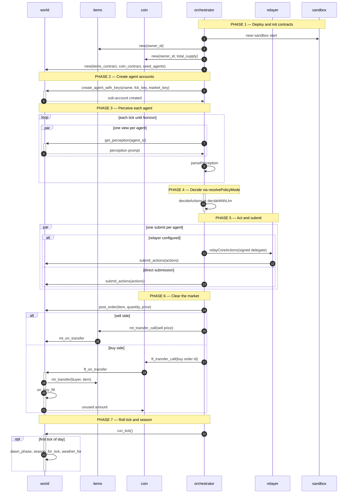

# eidolon

19 agents run a village economy on NEAR. Each villager holds a wallet, an inventory, a body, a job, and a daily routine. One deterministic tick resolves actions, production, spoilage, tax, and market settlement. Items are NEP-245 tokens (`MultiToken` derive: NEP-245 core, metadata, NEP-145 storage). Token ids are the 18 village goods. Coin is a NEP-141 fungible token with fixed supply and `decimals: 0`. This repository is an executable specification of contracts, scripted agents, and tests. [ATTRIBUTION.md](ATTRIBUTION.md) gives the origin and the pinned upstream revision.

**Tracks:** `games`, `agents`. **License:** MIT (`LICENSE`, `ATTRIBUTION.md`).



## Architecture

| Component | Account | Responsibility |
|---|---|---|
| `contracts/world` (`eidolon-world`) | `world.eidolon.testnet` | World state, tick, production, market escrow, mirrors, NEP-297 events, views |
| `contracts/items` (`eidolon-items`) | `items.eidolon.testnet` | NEP-245 item tokens. World owns, mints, and burns them |
| `contracts/coin` (`eidolon-coin`) | `coin.eidolon.testnet` | NEP-141 coin. Init mints a fixed supply to world. Transfers only |
| `orchestrator/` | off-chain | Fetches perception, chooses scripted or LLM actions, submits them, calls `run_tick` |

Views do not read token balances: `coin_balance_mirror` and `item_balance_mirror` record every balance change, and callbacks own all balance updates. Deployed WASM: 176,164 B (items), 138,149 B (coin), 282,138 B (world).

## Simulation rules

- 16 ticks per day, 7 per season, 112 per season; tick 1 is `Monday, 06:00`, spring, day 1; one tick is one simulated hour. No RNG, no wall clock: identical inputs produce identical state.
- Order ids are `(tick << 20) | seq`; fill ids use `next_fill_seq`. The sleep roll is `((tick / 16) * 19 + agent_index) % 100`.

## Quickstart

1. Install and run the zero-funds demo → see the snapshot block under [Dry-run demo](#dry-run-demo):

```bash
npm install
npm run demo
```

2. Optional, for a deployed sandbox/testnet instance (needs Rust, `cargo-near`, `near-cli-rs`):

```bash
(cd contracts/items && cargo near build non-reproducible-wasm)
(cd contracts/coin && cargo near build non-reproducible-wasm)
(cd contracts/world && cargo near build non-reproducible-wasm)
cp .env.example .env
# edit .env, then
bash scripts/deploy.sh
```

`scripts/deploy.sh` builds, deploys, and initializes items, coin, and world in sequence, and prints storage commands. Demo horizon defaults to 49 ticks (three simulated days); `EIDOLON_TICKS=112` runs a seven-day season.

## Dry-run demo

```text
eidolon demo: 19 agents, 49 ticks, zero real funds, scripted policy
day 1: wealth=642 gini_bps=3848 gdp=0 scarce=meat,medicine
day 2: wealth=642 gini_bps=3848 gdp=0 scarce=meat,medicine
day 3: wealth=642 gini_bps=3848 gdp=0 scarce=meat,medicine
day 4: wealth=642 gini_bps=3848 gdp=0 scarce=meat,medicine
demo complete: 4 dawn snapshots, 49 ticks
```

```text
49 ticks in 76.41s; 27.98 Tgas/tick
storage: 629,209 bytes across world/items/coin
```

Full suites recorded in `SUBMISSION-PREP.md`: `npm test` → 26 tests; `EIDOLON_DET_TICKS=112 npm test` → 2 determinism tests, digest `30271fa8011c33c045f3577ada4bd9a9b722fd0a82bbd435f72c55222ef9b46f`. Audit re-run on Ubuntu 24.04 (WSL2), Node 26: `node --import=tsx --test tests/unit.test.ts` → `tests 24 / pass 24 / fail 0`.

## Scope

Supported: NEP-245 items (owner-gated mint/burn, NEP-145 storage), fixed-supply NEP-141 coin, world state, economy tables, deterministic time and body rules, events, views, scripted and optional NEAR AI Cloud NPC policies, direct submission, owner-invoked ticks. Not included: village meetings, proposals, votes, laws, god mode, the scenario harness, world generation, multi-village travel, player-controlled agents, loans, hired labor, wages, and barter scanning.

## Platform limits

NEAR sandbox binaries support Linux x86_64, Linux aarch64, and macOS arm64; Windows and Intel macOS throw `Unsupported platform`, so run tests and demos inside WSL2 or Linux CI. Builds need only Rust. Node 26 is the pinned LTS line.

## Baseline, diff and dependencies

Baseline: tag `pre-hackathon` marks the imported brunnfeld-agentic-world tree at `788541d`.
Submission: tag `hackathon-submission` marks the submitted state (`git rev-parse --short hackathon-submission` prints it).
Diff: `git diff pre-hackathon..hackathon-submission`; after publishing, https://github.com/<owner>/<repo>/compare/pre-hackathon...hackathon-submission.
Libraries, templates and AI-generated code are listed in `ATTRIBUTION.md`.

## Attribution and license

This port derives from an MIT-licensed origin project. See [ATTRIBUTION.md](ATTRIBUTION.md) for itemized reuse. The repository uses the MIT license in [LICENSE](LICENSE). Hackathon tracks: `games`, `agents`. Q-015 (second project on this email): **portico** (x402 payment rail, tracks `realworld`, `business`).
