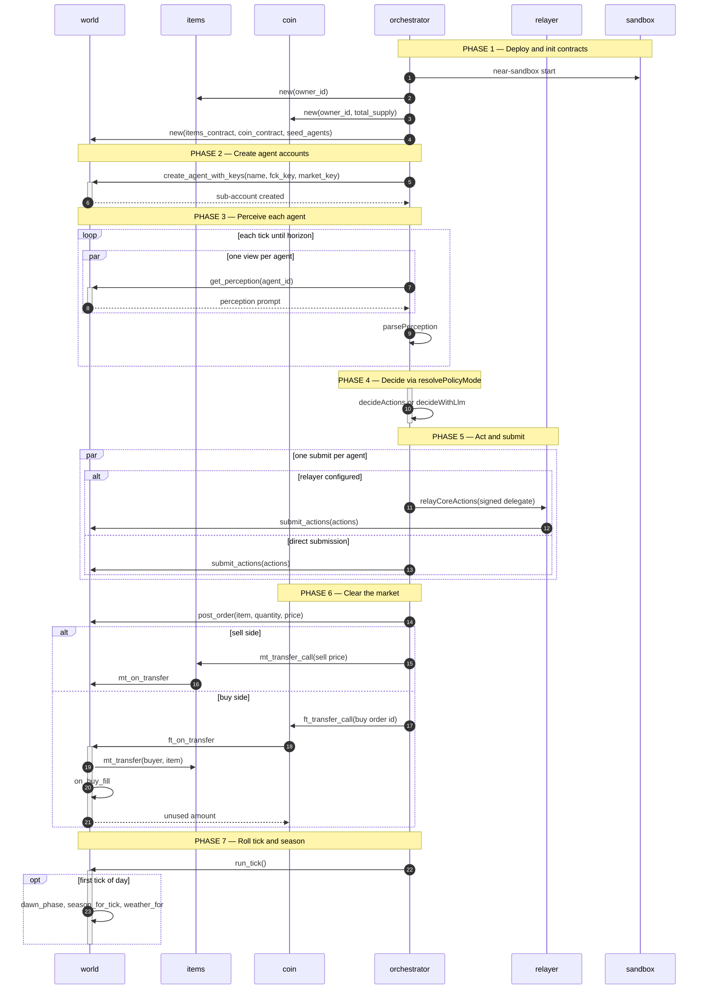

# eidolon

Tracks `games`, `agents` · licence MIT (`LICENSE`, `ATTRIBUTION.md`) · baseline `pre-hackathon` (`788541d`) to `hackathon-submission`, diff `git diff pre-hackathon..hackathon-submission` · Q-015 sibling portico (x402 payment rail, tracks `realworld`, `business`)

Nineteen scripted NPCs with wallets run a village economy on NEAR: each holds inventory, a job and a routine. One deterministic tick settles production, spoilage, tax and a market. Items are NEP-245 tokens, coin is NEP-141; agents act through orchestrator keys.



| Do this | See this | Proves |
|---|---|---|
| Quickstart: `npm install` · `npm run demo` | build/deploy sequence in the bash block; needs Rust, `cargo-near`, `near-cli-rs` | fresh clone builds from source |
| Smoke/measure: `EIDOLON_TICKS=112` | 27.98 Tgas/tick on a single-vCPU review host | reproducible, zero-funds economy |
| Tests: `npm test` · `EIDOLON_DET_TICKS=112 npm test` | 26 tests; 112-tick digest `30271fa8011c33c045f3577ada4bd9a9b722fd0a82bbd435f72c55222ef9b46f` | suites pass |
| Unit: `node --import=tsx --test tests/unit.test.ts` | 24 unit tests pass | unit vectors pass |
| `node demo.mjs` | tick output with production/tax/market settlement | deterministic economy loop |
| `cargo test --workspace` | contract and economy vectors pass | rules are tested |
| `coin_balance_mirror` · `item_balance_mirror` | NEP-245 items (NEP-145 storage), NEP-141 coin `decimals: 0`, 18 goods, NEP-297 events | token standards + mirror views |
| `git rev-parse --short hackathon-submission` · `git diff pre-hackathon..hackathon-submission` | baseline `pre-hackathon` at `788541d`; origin brunnfeld-agentic-world | pinned upstream revision |
| run in WSL2 or Linux CI | Windows and Intel macOS throw `Unsupported platform`; Node 26 is the pinned LTS | supported platforms |
| Limits | Not included: player-controlled agents, loans, hired labor, wages, and barter scanning | the repo's own documented limits |

```bash
(cd contracts/items && cargo near build non-reproducible-wasm)
(cd contracts/coin && cargo near build non-reproducible-wasm)
(cd contracts/world && cargo near build non-reproducible-wasm)
cp .env.example .env
bash scripts/deploy.sh
```

[ATTRIBUTION.md](ATTRIBUTION.md) · [LICENSE](LICENSE)
